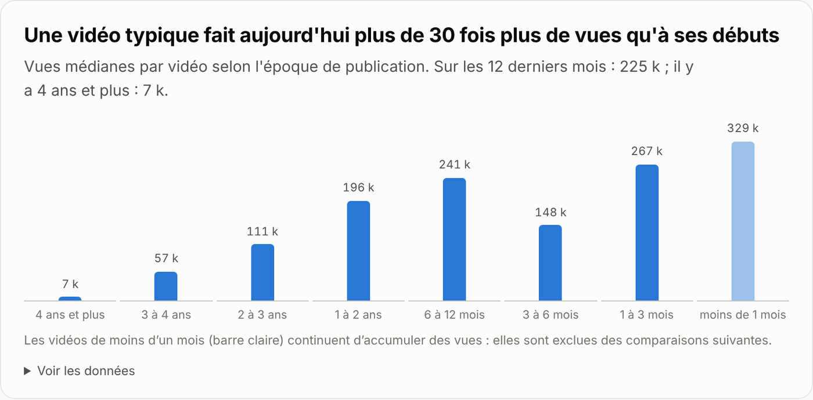
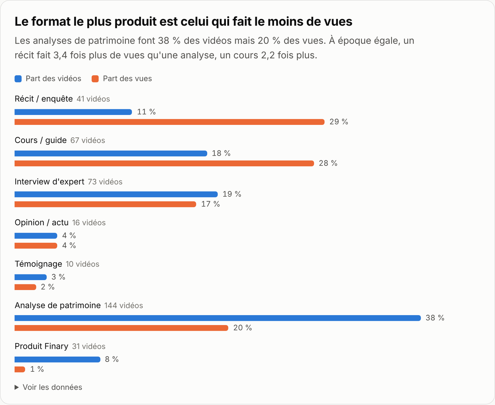
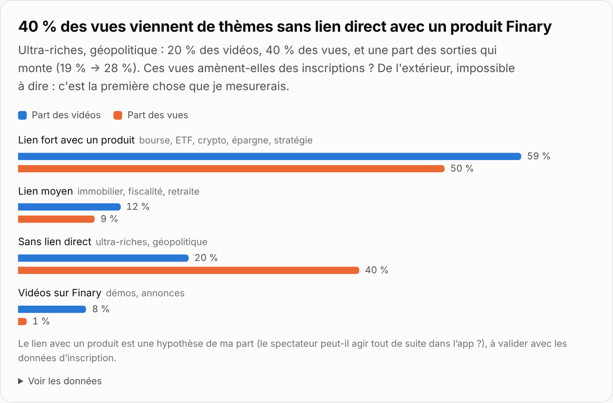
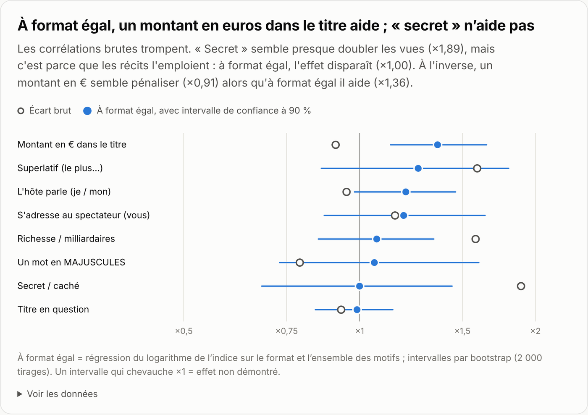

# Finary sur YouTube : ce qui fait des vues, et ce qu'il reste à mesurer

Analyse indépendante des **390 vidéos longues** de la chaîne YouTube de Finary (917 k abonnés) : formats, thèmes, titres, durée. Avec un tableau de bord interactif, un plan pour mesurer les inscriptions venues de YouTube, et un agent qui produit le rapport chaque semaine.

**[→ Ouvrir le tableau de bord](https://leopostollec.github.io/finary-youtube-growth/)** · [Plan de mesure](measurement/mesure-youtube-inscriptions.md) · [Agent hebdomadaire](agent/weekly_report.py) · [Données](data/videos.csv)

> Sans lien avec Finary. Données publiques relevées le 13 octobre 2026.

---

## En bref

**1. La chaîne a changé d'échelle.** Une vidéo longue typique fait **225 k vues** sur les 12 derniers mois, contre 7 k à ses débuts : plus de 30 fois plus.



**2. Le format le plus produit est celui qui fait le moins de vues.** Les analyses de patrimoine représentent **38 % des vidéos mais 20 % des vues**. À époque égale, un récit (milliardaires, entreprises, pays) fait **3,4 fois** plus de vues qu'une analyse, un cours ou un guide **2,2 fois** plus.



**3. La chaîne a déjà pivoté, vers des sujets éloignés du produit.** En un an, les analyses passent de 41 % à 26 % des sorties, les récits de 8 % à 21 %. Les thèmes sans lien direct avec un produit Finary (ultra-riches, géopolitique) font **20 % des vidéos et 40 % des vues**. Ces vues amènent-elles des inscriptions ? Les données publiques ne permettent pas de le dire. C'est la première chose que je mesurerais.



**4. Le point idéal : les cours sur l'investissement.** Parmi les thèmes où le spectateur peut agir tout de suite dans l'app, les cours sur la stratégie patrimoniale (×1,97) et sur la bourse (×1,61) réunissent audience et intention. Les analyses de patrimoine, cœur du produit, restent à ×0,63. (×1 = la vidéo typique de la même époque.)

**5. Les corrélations brutes trompent.** « Secret » dans un titre semble presque doubler les vues (×1,89), mais c'est parce que les récits l'emploient : à format égal, l'effet disparaît (×1,00). À l'inverse, un montant en euros semble pénaliser (×0,91) alors qu'à format égal il aide : **×1,36** (intervalle de confiance à 90 % : 1,13 à 1,65).



Et aussi : les vidéos de 45 minutes et plus font 1,46 fois la vidéo typique. Les Shorts touchent 8 fois moins de monde (27 k vues médianes sur les 48 derniers) ; ceux qui parlent de richesse montent à 70 k, ceux qui renvoient vers la vidéo complète plafonnent à 13 k.

## Comment améliorer la chaîne : 7 recommandations

Ce que je changerais dès maintenant, de l'impact le plus fort au plus simple à faire. Chaque recommandation repose sur un chiffre de l'analyse et vient avec sa mesure.

1. **Mettre à jour chaque année les guides débutants sur les produits.** Ce sont parmi les vidéos les plus fortes de la chaîne : « Guide débutant : investir 10 000 € » ×14,48, « PEA : le guide complet » ×5,57, « L'Assurance-Vie : le guide complet » ×2,92. Les titres qui portent l'année font ×1,97 contre ×0,97, et le spectateur peut agir tout de suite dans Finary. → Chaque janvier, une version datée des guides PEA, assurance-vie, PER, compte-titres, ETF et crypto.
2. **Moins d'analyses de patrimoine, mieux choisies.** 38 % des vidéos pour ×0,69. Les meilleures montrent un profil auquel beaucoup s'identifient (« Ingénieur de 25 ans avec 14 % de taux d'épargne » ×4,39) ou une personnalité (×1,22 contre ×0,69) ; les cas très particuliers (invalidité, expatriation, divorce, cession d'entreprise) tombent à ×0,29. → Choisir les candidats sur la représentativité et raconter l'analyse comme une histoire.
3. **Mettre le chiffre clé dans le titre.** À format égal, un montant en euros fait ×1,36 ; « secret », les majuscules et les questions n'ont pas d'effet démontré. → Salaire, patrimoine, mensualité ou objectif chiffré dans chaque titre d'analyse et de cours.
4. **Assumer les formats longs, passer les sujets courts en Shorts.** 45 minutes et plus : ×1,46 ; moins de 10 minutes : ×0,64. → Un sujet qui tient en moins de 10 minutes devient un Short ou un chapitre d'une vidéo plus longue.
5. **Des Shorts qui se suffisent à eux-mêmes.** Shorts sur la richesse : 70 k vues médianes ; les autres : 26 k ; ceux qui renvoient vers la vidéo complète : 13 k (4 cas, à confirmer). → Une histoire complète avec une accroche forte ; le lien vers la vidéo longue passe par la fonction « vidéo associée », pas par le titre.
6. **Faire travailler les récits pour le produit.** Les récits sur les ultra-riches font ×3,23, le meilleur score de la chaîne, sur un thème sans lien direct avec l'app. → Finir chaque récit par un pont vers le spectateur (« Et vous, comment est réparti votre patrimoine ? ») et un lien suivi vers la fonction de Finary qui y répond.
7. **Recycler ce qui surperforme.** 20 vidéos ont fait plus de six fois la vidéo typique de leur époque. → Toute vidéo au-dessus de ×2 à 28 jours est déclinée en article SEO, en Short autonome et en e-mail aux inscrits du même thème ; l'agent hebdomadaire les signale.

**Concrètement, un mois type de 9 vidéos longues** (rythme actuel : 8,7) : 3 cours ou guides sur l'investissement, 3 récits avec un pont vers le produit, 2 analyses ou témoignages de profils représentatifs, 1 interview longue. Un point de départ, à ajuster dès que les inscriptions pour 1 000 vues par format sont connues.

## Ce que je testerais en premier

Les recommandations jouent sur les vues. Ces trois tests vérifient qu'elles rapportent aussi des inscriptions.

| | Test | Mesure | Décision |
|---|---|---|---|
| 1 | **Mesurer les inscriptions pour 1 000 vues, par format** : un lien suivi par vidéo, un lien court dit à l'oral, « Comment as-tu connu Finary ? » à l'inscription | inscriptions pour 1 000 vues à 28 jours | si une analyse rapporte au moins 2,5 fois plus qu'un récit, elle garde sa place au calendrier ; sinon, on poursuit le virage |
| 2 | **Raconter les analyses de patrimoine comme des récits** : un enjeu, un montant, un retournement dès le titre. Retirer le libellé « Analyse de patrimoine » n'a rien changé (×0,55 avec ou sans) : c'est l'angle qui compte | indice à 28 jours et inscriptions pour 1 000 vues, 6 vidéos contre les 6 précédentes | on généralise si l'indice monte sans perte d'inscriptions |
| 3 | **Un parcours d'accueil par thème de vidéo** : inscrit depuis une vidéo ETF → parcours ETF (connecter son PEA, voir ses frais) ; depuis une vidéo crypto → parcours crypto | comptes connectés à 7 jours, passage payant à 30 jours, contre un groupe témoin | on étend si les deux montent |

Le premier conditionne les deux autres : sans inscriptions par vidéo, on optimise des vues.

## Mesurer ce que YouTube rapporte

[measurement/mesure-youtube-inscriptions.md](measurement/mesure-youtube-inscriptions.md) détaille le dispositif, pensé pour une à deux semaines de mise en place :

- **trois sources combinées** : liens suivis (UTM par vidéo et par emplacement), déclaratif à l'inscription (normalisé par un LLM vers une vidéo ou un thème), modèle global des inscriptions par jour face aux vues par jour ;
- **une règle d'attribution** explicite (lien cliqué dans les 30 jours, sinon déclaratif) et les trois chiffres publiés côte à côte, plutôt qu'un total qui cacherait l'incertitude ;
- **les requêtes SQL** (inscriptions pour 1 000 vues par format, passage payant à 30 jours par thème) et la maquette du tableau de bord.

## L'agent hebdomadaire

[agent/weekly_report.py](agent/weekly_report.py) automatise le suivi chaque lundi :

1. récupère les nouvelles vidéos avec l'API YouTube ([agent/youtube_api.py](agent/youtube_api.py)) ;
2. les classe par format et thème avec Claude, à partir d'un [prompt publié](agent/prompts/classify.md) (sortie JSON validée, repli sur des règles si la réponse est illisible) ;
3. calcule l'indice de performance face aux vidéos du même âge ;
4. écrit un rapport et propose des actions : décliner une vidéo qui dépasse ×2, tester un angle « récit » sur une analyse sous ×0,6, ne rien conclure avant 14 jours.

Les chiffres sont calculés en Python ; le LLM classe, il n'invente aucun chiffre. Un mode démo tourne sans aucune clé : [exemple de rapport](reports/demo.md).

```bash
python3 agent/weekly_report.py --demo        # sans clé, sur les données du dépôt
python3 agent/test_agent.py                  # 5 tests, sans réseau
YOUTUBE_API_KEY=… ANTHROPIC_API_KEY=… SLACK_WEBHOOK_URL=… python3 agent/weekly_report.py --days 28
```

## Méthode et limites

- **Collecte** : page publique de la chaîne, 389 vidéos longues, 1 live et les 48 Shorts les plus récents. Vues arrondies comme affichées (« 218 k »), dates relatives (« il y a 1 an »). `agent/youtube_api.py` récupère les chiffres exacts avec l'API YouTube.
- **Indice de performance** : vues ÷ vues médianes des vidéos publiées à la même époque. Il neutralise l'ancienneté et la croissance de la chaîne. Les vidéos de moins d'un mois sont exclues des comparaisons.
- **Étiquetage** : format et thème attribués par un LLM (Claude) avec le prompt du dépôt. Contrôle indépendant : un classifieur à règles ([analysis/taxonomy.py](analysis/taxonomy.py)) reconnaît un motif dans 302 titres sur 390 et donne alors le même format que le LLM dans 97 % des cas ; les 88 autres titres n'ont pas de mot-clé exploitable, c'est là que le LLM sert.
- **Effets « à format égal »** : régression du logarithme de l'indice sur le format et les motifs de titre, intervalles de confiance par bootstrap (2 000 tirages). Un intervalle qui chevauche ×1 = effet non démontré.
- **Hypothèse assumée** : le « lien avec un produit » d'un thème est mon jugement (le spectateur peut-il agir tout de suite dans l'app ?), à valider avec des données d'inscription.
- **Ce qui manque** : durée de visionnage, taux de clic, sources de trafic et inscriptions, que seuls YouTube Studio et Finary possèdent. Rien ici ne dit qu'un format convertit mieux qu'un autre : c'est l'objet du plan de mesure.

## Reproduire

```bash
pip install pandas numpy                 # pour l'analyse ; l'agent n'utilise que la bibliothèque standard
cd analysis && python3 build_dataset.py && python3 analyze.py && cd ..
python3 -m http.server -d docs 8000      # tableau de bord sur http://localhost:8000
```

```
data/raw/            relevé brut de la chaîne + étiquettes du LLM
data/videos.csv      jeu de données propre (une ligne par vidéo, 25 colonnes)
analysis/            taxonomie, classifieur de contrôle, construction du jeu, analyse -> results.json
docs/                tableau de bord (GitHub Pages) et images du README
agent/               agent hebdomadaire, collecte API YouTube, prompt de classement, tests
measurement/         plan de mesure YouTube -> inscriptions, avec les requêtes SQL
reports/demo.md      rapport produit par l'agent en mode démo
```

## In English

An independent analysis of Finary's 390 long-form YouTube videos. Portfolio reviews are 38 % of uploads but 20 % of views; stories about billionaires, companies and countries get 3.4× more views at equal age, and the channel has already shifted toward them. Half of that reach comes from topics with no direct link to a Finary product, so the open question is conversion, not views: the repo includes a plan to measure signups per 1,000 views by video (UTMs, self-reported attribution, an aggregate model, SQL), a weekly agent that classifies new videos with Claude and flags what to repurpose or retest, and a note on confounding: "secret" in a title looks like ×1.9 but is ×1.0 once format is controlled for, while a euro amount looks negative but is ×1.36.

## À propos

Léo Postollec, étudiant en Programme Grande École à SKEMA Business School (Sophia Antipolis). Je veux travailler sur la croissance de produits grand public, avec l'IA comme outil de tous les jours. Ce projet montre ma façon de travailler : partir des données, vérifier ce qu'elles disent vraiment, finir par des tests qui se mesurent.

Réalisé avec Claude (Anthropic) comme assistant IA pour la collecte, l'étiquetage et le code. Code sous licence MIT ; les titres et chiffres de vues restent ceux de la chaîne publique de Finary.
